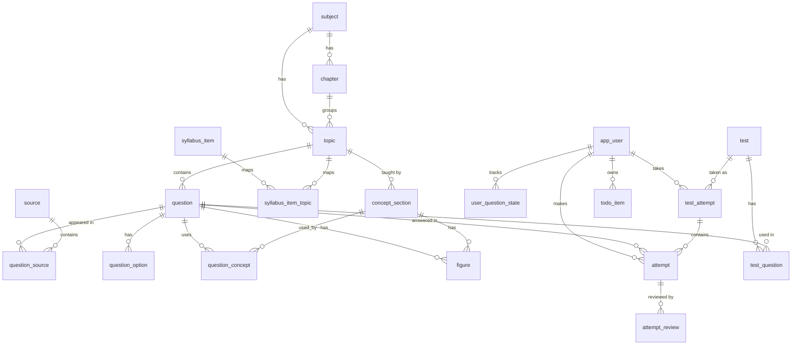

# Database guide

Postgres 18 on Neon (Singapore). Local tests use the same version (Postgres 18.7 binaries from Maven: io.zonky.test.postgres:embedded-postgres-binaries-linux-amd64). Schema is managed **only** by Flyway migrations in
`src/main/resources/db/migration`. Migrations run at app startup (see `StartupConfig`).

## Rules
1. **Never edit a migration that has run on Neon.** Flyway checks file checksums and the app will refuse to start.
   To change the schema, add a new file `V<next>__short_name.sql`.
2. **Before a risky migration** (drop, rename, data move): create a Neon branch as a backup
   (Neon console -> Branches -> Create branch from `production`), then deploy.
3. **Test every migration locally** on a database that is in the same state as production
   (run the app once with `--spring.flyway.target=<current version>`, then run it normally).
4. Guard data moves: a migration that drops a column first checks the column is empty (see V3).
5. Names: `snake_case`, tables in singular (`question`, `topic`), indexes `idx_<table>_<cols>`,
   unique indexes `ux_<table>_<cols>`, triggers `trg_<table>_updated_at`.
6. Every main table has `created_at` / `updated_at`; `updated_at` is kept by the `set_updated_at()` trigger.
7. Allowed values are enforced with `CHECK` constraints, not only in Java.
8. Content (questions, notes, syllabus) is loaded through versioned import files; each import is logged in `content_import`.
9. Deleting a user deletes their attempts, reviews, test attempts, revision state and to-dos (`ON DELETE CASCADE`).

## Migrations
| Version | What |
|---|---|
| V1 | First schema: subject, chapter, topic, source, question, users, attempts, revision state |
| V2 | Seed: 11 subjects, 373 topics, 24 papers, 1,740 tagged questions (APSC 2023 + GATE EE 2007-2026), 288 GATE-state links |
| V3 | Schema v2: many sources per question, options, figures, concept notes, syllabus, tests, reviews, to-dos, user approval, notification outbox, import log |
| V4 | Roles USER / ADMIN (was STUDENT / ADMIN), Google profile picture, index on user status |

## Tables

### Content
| Table | Purpose |
|---|---|
| `subject` | e.g. Electric Circuits. `in_syllabus=false` for Engineering Maths and 8085 (not in APGCL syllabus) |
| `chapter` | groups topics inside a subject |
| `topic` | smallest study unit; questions and concept notes hang here |
| `syllabus_item`, `syllabus_item_topic` | official syllabus lines and which topics cover them |
| `concept_section` | teaching notes for a topic, in order (Markdown + LaTeX), DRAFT/PUBLISHED |
| `source` | one exam paper (APDCL-2023, GATE-2014, ESE-2019...) with its marking scheme |
| `question` | the question: stem, solution, type (MCQ/MSQ/NAT), nature (NUMERICAL/THEORY), difficulty, answer status |
| `question_source` | where a question appeared (paper + question number). One question can have many |
| `question_option` | options A-E, `is_correct` marks the key |
| `question_concept` | which concept section a question uses |
| `question_link` | related (not identical) questions: `exact` / `values` / `concept` level |
| `figure` | diagrams for a question or a concept section (files in object storage) |

`question.answer_status`: `OFFICIAL_KEY` (official answer key) > `TWO_SOURCES` (two independent sources agree)
> `REVIEWED` (solved and reviewed) > `UNVERIFIED`.

### Users and learning
| Table | Purpose |
|---|---|
| `app_user` | account (Google sign-in); `role` USER or ADMIN; `status` PENDING until approved in the admin section |
| `attempt` | every answer given: mode (STUDY/PRACTICE/TEST/REVISION), chosen option(s) or NAT value, time, own working |
| `attempt_review` | the review of an attempt: verdict and explanation |
| `user_question_state` | revision state per user and question (Leitner box, next review, bookmark, counts) |
| `test`, `test_question`, `test_attempt` | PYQ papers, mocks, chapter/topic tests and their attempts |
| `todo_item` | to-dos, optionally linked to a topic |
| `exam_event` | exam countdown (date stays null until officially notified) |

### Operations
| Table | Purpose |
|---|---|
| `notification_outbox` | emails to send (e.g. signup alerts). Not used yet: login is Google-only with approval in the admin section |
| `content_import` | log of content files imported (name + sha256) |

## Diagram

